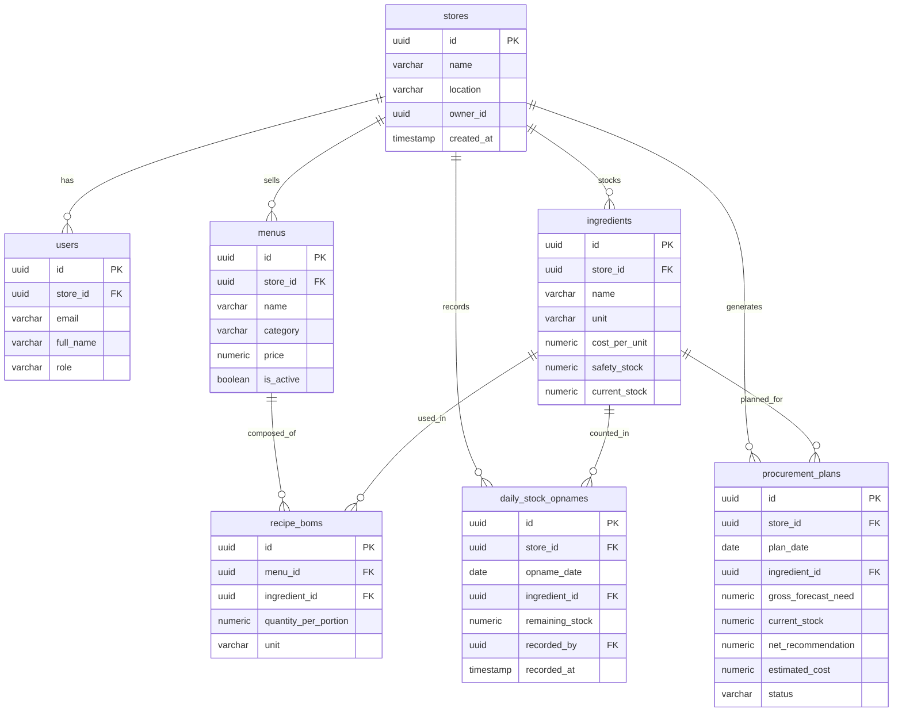

# PRODUCT REQUIREMENTS DOCUMENT (PRD)
## SISA-BIJAK (Platform Audit Sisa Pangan & Rekomendasi Pengadaan Bahan Baku Berbasis Analitik Prediktif)

---

### METADATA DOKUMEN
- **Nama Produk**: SISA-BIJAK (*Smart Inventory & Sustainability Analytics - Bahan Baku Efisien, Kurangi Sisa Makanan*)
- **Versi**: 1.0.0-PROD-SPEC
- **Status**: Ready for Architecture & Implementation Review
- **Target Pengguna**: Pemilik Usaha Kuliner (Owner/Manager) & Tim Dapur (Kitchen Staff)
- **Konteks Implementasi**: UMKM Kuliner Indonesia (Pilot Case: *Ayam Geprek Sambal Korek Barokah - Purwokerto Branch*)
- **Arsitek & Lead**: Senior Fullstack Engineer & Data Science Architect

---

## 1. EXECUTIVE SUMMARY & LATAR BELAKANG

### 1.1 Problem Statement
Sektor UMKM kuliner di Indonesia menghadapi permasalahan ganda yang menggerus profitabilitas sekaligus meningkatkan dampak lingkungan:
1. **Capital Lockup & Kerusakan Bahan Mudah Rusak (Perishables)**: Bahan basah seperti karkas ayam, cabai rawit, bumbu rempah, sayuran, dan susu/keju sering dibeli berdasarkan intuisi ("kira-kira"). Akibatnya terjadi kelebihan persediaan (*overstocking*) yang berujung pada kebusukan bahan (*food loss/waste*).
2. **Ketiadaan Konversi Otomatis Penjualan ke Bahan Mentah (Reverse-BOM Gap)**: Restoran mengetahui menu yang terjual (misal: 100 porsi Ayam Geprek), namun tidak memiliki mekanisme instan untuk menghitung secara presisi berapa gram daging ayam, beras, cabai, dan minyak yang terpakai dan berapa sisa fisik yang ada di gudang.
3. **Proses Stock Opname yang Memakan Waktu & Rentan Manipulasi**: Pencatatan akhir hari (*closing shift*) kerap dilakukan secara manual menggunakan nota kertas atau chat WhatsApp tanpa integrasi langsung ke sistem kalkulasi belanja esok hari.
4. **Fluktuasi Permintaan Eksternal yang Dinamis**: Penjualan kuliner di kota seperti Purwokerto sangat dipengaruhi oleh hari libur kalender/kuliah, akhir pekan (*weekend surge*), dan cuaca harian (curah hujan lereng Gunung Slamet yang tinggi memicu pergeseran antara *dine-in* dan *take-away*).

### 1.2 Solusi: SISA-BIJAK
SISA-BIJAK menghadirkan platform cerdas yang menggabungkan:
- **Analitik Prediktif Permintaan (XGBoost Regressor)**: Memproyeksikan estimasi porsi menu terjual untuk 1–7 hari ke depan dengan mempertimbangkan faktor musiman, hari kerja/libur, dan curah hujan.
- **Mesin Reverse-BOM (Bill of Materials Engine)**: Mengonversi proyeksi porsi menu menjadi kebutuhan kotor bahan baku (*Gross Ingredient Requirement*).
- **Audit Sisa Fisik & Kalkulasi Belanja Bersih (Net Procurement Engine)**: Membandingkan kebutuhan kotor + safety stock terhadap hasil Stock Opname fisik penutupan dapur.
- **Early Warning Dead-Stock Alert**: Memberikan status peringatan tegas **"STOP RESTOCK / JANGAN BELI"** jika stok masih mencukupi beberapa hari ke depan, menghentikan kebocoran modal belanja UMKM.

---

## 2. BRANDING, DESIGN SYSTEM & TEMA VISUAL

### 2.1 Palet Warna ("Refined Culinary Gold & Deep Navy")
- **Primary Accent (Warm Golden Glow)**: `#D4AF37` / `#E5C158` (Melambangkan kemakmuran, kematangan kuliner, serta efisiensi emas).
- **Primary Dark Contrast (Deep Slate/Navy)**: `#0F172A` (Slate-900) & `#1E293B` (Slate-800) untuk kedalaman kontras eksekutif.
- **Background Layering**: `#F8FAFC` (Slate-50) & `#FFFFFF` (Crisp White) dengan batas halus `#E2E8F0` (Border Slate-200).
- **Semantic Alert Badges**:
  - **REKOMENDASI BELI (Need Restock)**: Emerald Green / Teal Accent (`#10B981` / `#059669`) dengan background soft green `#ECFDF5`.
  - **STOP RESTOCK / JANGAN BELI (Overstock Alert)**: Crimson Velvet / Amber Gold (`#E11D48` / `#D97706`) dengan badge menyala untuk menghentikan pemborosan modal.
  - **SAFE BUFFER (Stok Aman)**: Soft Golden Blue (`#3B82F6` / `#D4AF37`).

### 2.2 Tipografi & Komponen UI
- **Font Primer**: *Plus Jakarta Sans* / *Inter* dengan rendering tajam *antialiased*.
- **Card Styling**: Radius `rounded-2xl`, subtle golden rim highlight (`border border-amber-200/50 shadow-sm hover:shadow-md transition-all`), micro-interactions responsif.
- **Header Navigasi Sticky**:
  - Logo SISA-BIJAK dengan aksen icon *Golden Wheat / Leaf* bernuansa minimalis modern.
  - **Store Context Chip**: *"Ayam Geprek Sambal Korek Barokah - Purwokerto Branch"* lengkap dengan dropdown multi-cabang.
  - **User Role Badge & Switcher**: Menampilkan status *"Owner / Manager"* atau *"Kitchen Staff"*, memungkinkan simulasi perpindahan persona seketika (*Instant Role Switcher*).

---

## 3. USER PERSONAS & USER JOURNEY MAP

```
+-----------------------------------------------------------------------------------+
| PERSONA 1: Pak Barokah (Owner / Manager)                                         |
+-----------------------------------------------------------------------------------+
| * Motivasi  : Memaksimalkan margin keuntungan, menekan modal kerja tertahan,      |
|               mengontrol belanja bahan tanpa harus mencocokkan nota manual.      |
| * Akses UI  : Executive Dashboard, KPI Finansial, Model Forecast, Pengaturan BOM, |
|               Approval Belanja Harian & Ekspor List Belanja ke WhatsApp Supplier. |
+-----------------------------------------------------------------------------------+

+-----------------------------------------------------------------------------------+
| PERSONA 2: Mas Budi (Kitchen Staff / Chef Closing)                                |
+-----------------------------------------------------------------------------------+
| * Motivasi  : Menyelesaikan opname sisa bahan fisik dalam waktu singkat (<3 menit)|
|               tanpa formulir rumit sebelum menutup outlet/dapur.                 |
| * Akses UI  : Fast Stock Opname Mobile Form, Quick Stepper / Direct Numpad Input, |
|               Konfirmasi Serah Terima Shift.                                     |
+-----------------------------------------------------------------------------------+
```

---

## 4. ARSITEKTUR SISTEM & PRINSIP CLEAN ARCHITECTURE (OOP)

SISA-BIJAK dibangun mengikuti prinsip **Separation of Concerns (Clean Architecture)**:

```
               +---------------------------------------------+
               |        Presentation Layer (UI/Pages)        |
               |  - Executive Dashboard (Owner View)         |
               |  - Stock Opname Fast Form (Staff View)      |
               |  - BOM Modal & Store Switcher Component     |
               +----------------------+----------------------+
                                      |
                                      v
               +---------------------------------------------+
               |          Domain Entities & Models           |
               |  - Ingredient, Menu, RecipeBOM              |
               |  - StockOpname, ProcurementRecommendation    |
               +----------------------+----------------------+
                                      |
                                      v
               +---------------------------------------------+
               |               Service Layer                 |
               |  - ForecastingService (XGBoost Predictor)   |
               |  - InventoryEngine (Reverse-BOM & Net Need) |
               |  - AuthService & RoleContext                |
               +----------------------+----------------------+
                                      |
                                      v
               +---------------------------------------------+
               |          Repository / Data Layer            |
               |  - IStoreRepository, IIngredientRepository   |
               |  - IMenuRepository, IProcurementRepository  |
               |  - Supabase Database / Mock InMemory Adapter|
               +---------------------------------------------+
```

### 4.1 Domain Entities
1. `Ingredient`: Merepresentasikan entitas bahan mentah, satuan (`kg`, `gram`, `liter`, `butir`), harga pokok per unit (`cost_per_unit`), `safety_stock`, dan `current_stock`.
2. `Menu`: Merepresentasikan produk jadi restoran (kategori, harga jual, status aktif).
3. `RecipeBOM`: Relasi resep porsi (*Bill of Materials*) yang mendefinisikan kuantitas gramasi bahan mentah per porsi menu.
4. `StockOpname`: Hasil audit sisa bahan fisik akhir hari per tanggal dan petugas pencatat.
5. `ProcurementPlan`: Entitas kalkulasi rekomendasi pengadaan harian beserta status keputusan (`BELI` vs `STOP RESTOCK`).

### 4.2 Service Layer
- **`ForecastingService`**: Menghitung prediksi porsi menu harian menggunakan bobot variabel regresi berbasis *feature engineering*:
  $$\text{Prediksi Porsi}_m = \text{BaseDemand}_m \times \text{Factor}(\text{DayOfWeek}) \times \text{Factor}(\text{Weekend}) \times \text{Factor}(\text{Holiday}) \times \text{Factor}(\text{Rainfall})$$
- **`InventoryEngine`**:
  - *Gross Need*: $\text{Gross}_i = \sum_{m} (\text{Predicted Portions}_m \times \text{BOM Grams}_{m, i})$
  - *Net Need*: $\text{Net}_i = (\text{Gross}_i + \text{Safety Stock}_i) - \text{Physical Remaining Stock}_i$
  - *Status Evaluator*:
    - Bila $\text{Net}_i > 0 \rightarrow$ Status `REKOMENDASI BELI` dengan kuantitas yang disesuaikan satuan belanja.
    - Bila $\text{Net}_i \le 0 \rightarrow$ Status `STOP RESTOCK / JANGAN BELI` (menghitung berapa hari daya tahan stok yang ada).
- **`AuthService`**: Menangani otentikasi peran `OWNER` dan `STAFF` dengan pergantian konteks instan untuk kenyamanan uji coba.

### 4.3 Repository Layer (Interface Decoupling)
- Menggunakan arsitektur berbasis antarmuka (*Interface-based repository pattern*).
- Mendukung dua mode penyimpanan:
  1. **Supabase Client Driver**: Menghubungkan langsung ke cloud database PostgreSQL Supabase dengan Row Level Security (RLS).
  2. **In-Memory Fallback Driver**: Menyediakan *fallback instant run* tanpa konfigurasi awal, memuat seed data Purwokerto secara mandiri.

---

## 5. SPESIFIKASI SKEMA DATABASE (SUPABASE POSTGRESQL)



---

## 6. FITUR DETAIL & ALUR PENGGUNA (FLOW SPECIFICATIONS)

### 6.1 Flow 1: Otentikasi & Role Switcher
- Layar login elegan dengan kartu beraksen *Warm Gold*.
- Tombol Preset Cepat (Quick Switcher):
  - **Demo Owner** (`owner@sisabijak.com`): Melihat metriks finansial, proyeksi forecast, edit resep BOM, dan persetujuan belanja.
  - **Demo Kitchen Staff** (`staff@sisabijak.com`): Langsung diarahkan ke modul formulir cepat Stock Opname closing dapur.

### 6.2 Flow 2: Predictive Forecasting & Reverse-BOM Engine
- **Karakteristik Model Forecast**:
  - Menggunakan algoritma XGBoost Regressor (atau modul prediktif analitik berbobot tinggi).
  - Variabel input harian:
    - `DayOfWeek` (Senin-Minggu).
    - `IsWeekend` (Sabtu-Minggu lonjakan konsumsi keluarga).
    - `IsHoliday` (Hari libur nasional/tanggal merah).
    - `Rainfall_mm` (Faktor cuaca: Hujan lebat memicu pesanan pesan-antar namun menurunkan pembeli langsung).
- **Proses Reverse-BOM**:
  - Mengambil data porsi menu yang diprediksi untuk esok hari ($D+1$).
  - Melakukan perkalian silang matriks porsi $\times$ gramasi per menu.
  - Menghasilkan daftar total kebutuhan kotor per bahan baku (*Gross Need*).

### 6.3 Flow 3: Executive Dashboard (Owner View)
- **Top 4 KPI Metrics Cards**:
  1. **Total Penghematan Modal Kerja (Rp)**: Akumulasi nilai belanja yang berhasil dicegah dari bahan berstatus "STOP RESTOCK".
  2. **Total Menu Diprediksi Terjual (Porsi)**: Jumlah porsi seluruh varian menu esok hari.
  3. **Jumlah Bahan Status "STOP RESTOCK"**: Indikator bahan yang tidak boleh dibeli agar tidak busuk/dead-stock.
  4. **Indeks Potensi Food Waste Tercegah (%)**: Rasio efisiensi pemanfaatan persediaan terhadap potensi pembusukan.
- **Visualisasi Interaktif (Recharts)**:
  - Grafik Perbandingan Tren: Prediksi Permintaan vs Konsumsi Historis 7 Hari.
  - Distribusi Alokasi Kebutuhan Bahan Baku Kunci.
- **Smart Procurement Table**:
  - Menampilkan daftar bahan, satuan, stok gudang saat ini, kebutuhan esok hari, saran belanja bersih, dan status.
  - Fitur Filter:
    - *Semua Bahan*
    - *Hanya yang Perlu Dibeli (Restock Needed)*
    - *Hanya Stop Restock (Avoid Waste)*
  - **Fitur Ekspor**:
    - Ekspor PDF Formal (Daftar Pembelian Harian).
    - Ekspor Teks Format WhatsApp: Format siap kirim ke grup supplier pasar/tengkulak sekali klik (*Copy to Clipboard* atau *Send to WhatsApp*).

### 6.4 Flow 4: Closing Stock Opname Cepat (Kitchen Staff View)
- Formulir input audit fisik sisa bahan dapur yang didesain tuntas dalam waktu **kurang dari 3 menit**.
- Input dengan kontrol responsif:
  - Tombol inkremen/dekremen cepat ($+1$, $+0.5$, $+0.1$) atau input angka langsung.
  - Indikator satuan jelas (misal: "Kg", "Gram", "Liter").
- Tombol *"Simpan & Hitung Ulang Kebutuhan Belanja"* yang secara reaktif memicu pembaruan kalkulasi di dashboard Owner secara real-time.

### 6.5 Flow 5: Menu & BOM Configuration Modal
- Modal interaktif untuk meninjau dan menyesuaikan gramasi resep setiap menu.
- Contoh konfigurasi:
  - *Paket Geprek Original*: 180g Ayam Karkas, 120g Beras, 30ml Minyak, 15g Cabai Rawit, 10g Bawang Putih, 40g Tepung Bumbu.
  - *Paket Geprek Keju Mozarella*: 180g Ayam Karkas, 120g Beras, 30ml Minyak, 15g Cabai Rawit, 50g Keju Mozarella.
- Fitur penambahan bahan baru dan penyesuaian gramasi secara dinamis.

---

## 7. DATASET DUMMY REALISTIS (PURWOKERTO CULINARY CASE)

Data awal telah disesuaikan dengan kondisi riil usaha kuliner di Purwokerto (*Ayam Geprek Sambal Korek Barokah*):
1. **Daging Ayam Karkas**:
   - Stok fisik gudang: 5.5 Kg (Menipis).
   - Prediksi kebutuhan kotor: 12.0 Kg.
   - Safety stock: 2.0 Kg.
   - **Keputusan**: `REKOMENDASI BELI` $\rightarrow$ **8.5 Kg** (Restock prioritas).
2. **Keju Mozarella**:
   - Stok fisik gudang: 4.2 Kg (Dead-stock melimpah akibat pembelian berlebih minggu lalu).
   - Prediksi kebutuhan kotor: 0.6 Kg/hari.
   - **Keputusan**: `STOP RESTOCK / JANGAN BELI` (Stok aman mencukupi untuk 7 hari ke depan, menghemat modal Rp 400.000+).
3. **Cabai Rawit Merah**:
   - Komponen krusial sambal korek khas Purwokerto yang sangat rentan membusuk dalam 48 jam jika terkena kelembapan tinggi.
   - Rekomendasi dihitung presisi harian agar tidak ada cabai busuk terbuang.
4. **Minyak Goreng, Beras Pulen, Bawang Putih, Tepung Bumbu, Gula & Teh Jumbo**:
   - Dihitung sesuai skala porsi harian.

---

## 8. NON-FUNCTIONAL REQUIREMENTS (NFR)
- **Performance**: Waktu muat halaman pertama $\le 1.5$ detik; waktu kalkulasi ulang Reverse-BOM $\le 100$ ms.
- **Mobile Friendliness**: Form Stock Opname Kitchen Staff 100% responsif pada layar smartphone (layar 360px ke atas) dengan tombol sentuh berukuran ramah jari (*finger-friendly buttons*).
- **Maintainability & Type Safety**: Kode berbasis TypeScript dengan tipe data ketat (*strict types*), zero-any policy pada model inti.
- **Security**: Sanitasi input data stok, enkripsi environment variables untuk koneksi Supabase, serta pembatasan mutasi resep hanya untuk peran `OWNER`.

---

## 9. ROADMAP IMPLEMENTASI TEKNIS

| Fase | Durasi | Sasaran & Deliverables |
| :--- | :--- | :--- |
| **Fase 1 (Selesai)** | Perencanaan | Pembuatan PRD komprehensif, pemetaan arsitektur Clean Architecture, spesifikasi skema Supabase. |
| **Fase 2** | Setup & Core Domain | Inisialisasi arsitektur proyek, Domain Entities (`Ingredient`, `Menu`, `RecipeBOM`, `ProcurementPlan`), Repository Interfaces, dan Mock Repository Adapter. |
| **Fase 3** | Logic & Engine | Implementasi `ForecastingService` (Simulasi XGBoost dengan fitur cuaca & hari libur), `InventoryEngine` (Reverse-BOM & kalkulasi netto), dan `AuthService`. |
| **Fase 4** | UI/UX & Dashboard | Pembuatan antarmuka visual bertema *Refined Culinary Gold*: Header, Store Chip, Switcher Role, KPI Cards, Grafik Recharts, dan Tabel Belanja Cerdas. |
| **Fase 5** | Kitchen View & BOM Modal | Pembuatan formulir cepat Stock Opname (< 3 menit) untuk Staff, modal konfigurasi resep BOM, dan fitur ekspor WhatsApp / PDF. |
| **Fase 6** | Integrasi Supabase & QA | Pengujian alur kerja penuh (*end-to-end*), penyediaan skrip migrasi SQL Supabase, serta dokumentasi instruksi instalasi dan eksekusi lokal. |
